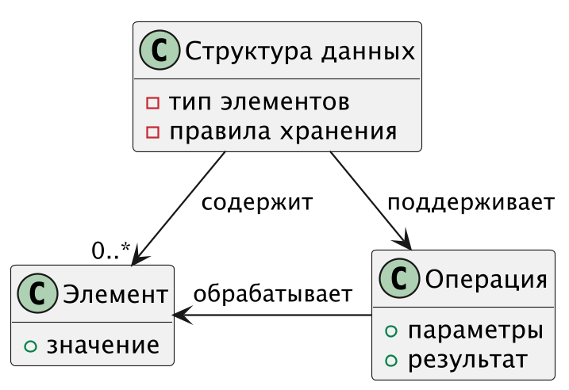

# Дизайн системы

## 1. Постановка задачи

Система должна предоставлять структуры данных для хранения и обработки элементов и позволять проверять их операции на собственных данных и готовых примерах.

Структуры предназначены для разных задач: упорядоченного поиска, выбора минимального или максимального значения, обработки данных по важности, доступа по индексу и поиска по ключу.

## 2. Сущности задачи

**Элемент** — хранимое значение: число, строка или объект пользовательского типа.

**Структура данных** — контейнер, который определяет способ хранения элементов и доступные операции.

**Операция** — действие над структурой: добавление, поиск, удаление, чтение или преобразование данных.

## 3. Архитектура

### 3.1 Набор компонентов

**Интерфейс** принимает значения и параметры операций, показывает состояние структуры и результаты проверок.

**Модуль операций** вызывает методы выбранной структуры и обрабатывает ошибки входных данных.

**Структуры данных** определяют хранение элементов и реализуют основные алгоритмы.

### 3.2 Схема связи

### 3.3 Структуры и задачи, для которых они предназначены

| Структура                  | Назначение                                                                     | Пример задачи |
|----------------------------|--------------------------------------------------------------------------------|---|
| **AVL-дерево**             | Хранение значений в упорядоченном виде с быстрым поиском, вставкой и удалением | Каталог товаров: найти товар по коду, добавить новый или удалить существующий |
| **Бинарная куча**          | Выбор наибольшого (наименьшего) значения за О(1)                               | Расписание: выбрать событие с ближайшим временем наступления |
| **Очередь с приоритетами** | Обработка элементов по важности                                                | Очередь заявок: сначала обработать срочные обращения, затем обычные |
| **Динамический массив**    | Хранение последовательности с доступом по индексу и изменяемым размером        | Измерения по дням: получить значение за выбранный день |
| **Хеш-таблица**            | Поиск значения по ключу без необходимости поддерживать порядок                 | Справочник: найти номер телефона по имени |

## 4. Функциональные требования

### AVL-дерево должно позволять:

- Создавать пустое дерево для выбранного типа элементов.
- Добавлять элемент.
- Проверять наличие элемента и удалять его. Удаление отсутствующего значения должно возвращать `false`.
- Получать максимальный элемент и извлекать его с удалением.
- Получать высоту дерева и проверять, пусто ли оно.
- Сохранять AVL-баланс после вставки и удаления элементов.
- Сообщать об ошибке при получении или извлечении максимума из пустого дерева.

### Бинарная куча должна позволять:

- Cоздавать минимальную или максимальную кучу.
- Добавлять элементы, в том числе повторяющиеся.
- Получать первый элемент: минимум для минимальной кучи или максимум для максимальной.
- Получать количество элементов и проверять, пуста ли куча.

### Очередь с приоритетом должна позволять:

- Создавать пустую очередь и добавлять значение с целочисленным приоритетом.
- Хранить одинаковые значения и элементы с одинаковыми приоритетами.
- Получать без удаления и извлекать с удалением значение с наибольшим приоритетом.
- При равных приоритетах сначала извлекать последний добавленный элемент.
- Проверять, пуста ли очередь.

### Динамический массив должен позволять:

- Создавать пустой массив, массив заданного размера или копию переданной последовательности.
- Получать длину массива.
- Читать и изменять элементы по индексу.
- Изменять размер, сохраняя общую часть прежнего и нового массива. Новые элементы должны получать значения по умолчанию для своего типа.
- Обменивать содержимое двух массивов.

### Хеш-таблица должна позволять:

- Создавать пустую таблицу.
- Добавлять пару с новым ключом. При попытке добавить уже существующий ключ должна сообщаться ошибка.
- Проверять наличие ключа и получать значение по нему.
- Изменять значение существующего ключа и удалять пару.
- Хранить и находить разные ключи, попавшие в одну корзину, с помощью цепочек узлов.

### Система должна позволять:

1. Выбирать структуру и тип значений, вводить данные вручную и просматривать текущее содержимое.
2. Выполнять операции выбранной структуры и показывать их результаты или сообщения об ошибках.
